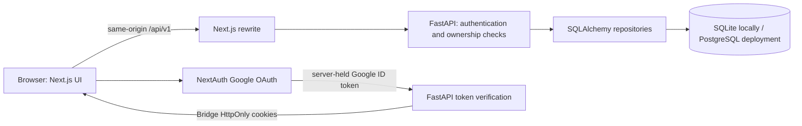

> Current provider update (27 October 2026): Gemini replaces xAI. See AI-SETUP.md for GEMINI_API_KEY, free-tier limits and Google data-use terms. Historical implementation notes below may reference the former provider.

# Architecture and integration contract

> **Current AI contract:** [Grok integration](AI-SETUP.md) documents the added routes, consent model, gateway, safety/evidence checks, transactions, data limits and migration. Sections below describe the original persistence baseline; statements that AI is absent are superseded by that contract.

## Source and decisions

Integrated from `Project-Bridge-Frontend-main.zip`, `Project_Bridge_Backend-main.zip`, and `Group 1 (3).pdf`. The PDF is a product/design baseline, not an instruction to publish, contact anyone, or provision services. Its technology recommendations were evaluated against the existing code: Next.js 16.3.7, React 19, NextAuth 4, FastAPI, SQLAlchemy, and Alembic are retained. A wholesale migration to every suggested library would not help the existing team start work.

There is currently **no LLM provider call**. Add a backend model gateway only after implementing consent filtering, safety routing, structured evidence/inference separation, and output validation. UI flags alone are not a sufficient permission check.

## Identity and session lifecycle

Password signup creates a hashed credential; login sets a 15-minute access token and seven-day refresh token by default. Refresh tokens are stored hashed and rotated; replay outside the existing 10-second concurrent-refresh grace period revokes the user's refresh sessions. Logout revokes refresh credentials and clears browser cookies. A copied access token remains usable until its short expiry because access tokens are stateless.

Cookies use HttpOnly and SameSite=Lax. The refresh cookie path is `/api/v1/auth`; the access cookie path is `/`. Local HTTP uses `COOKIE_SECURE=false`. HTTPS deployment must set it true, set a stable `NEXTAUTH_URL`, restrict `ALLOWED_ORIGINS`, and terminate TLS appropriately.

The frontend's `apiRequest` includes cookies, has timeouts, parses API errors, and shares one refresh request among concurrent failures within a tab. AppShell redirects unauthenticated users and requires onboarding. The backend independently authorizes each request; route guards are not security boundaries. Cross-tab refresh races can still require retry/relogin when a losing tab receives the grace-period 401.

Google OAuth uses NextAuth for the browser redirect. Its encrypted server-readable session token retains the Google ID token, which `/api/auth/bridge` sends directly to FastAPI; it is not returned in the client session object. FastAPI verifies it and identifies users by stable Google `sub`, then issues Bridge cookies. Matching an existing email alone never links accounts. References: [Google verification guide](https://developers.google.com/identity/gsi/web/guides/verify-google-id-token), [Google Auth token verifier](https://googleapis.dev/python/google-auth/latest/reference/google.oauth2.id_token.html).

## Data and permissions

| Data | Ownership/storage | Behavior |
|---|---|---|
| User, refresh token | Account; SQL database | Password hash, verified Google subject, rotated refresh hashes |
| UserPreferences | One per account | History, memory, context, reflections, appearance, onboarding |
| Conversation / Message | Conversation belongs to account | Mode per message; message deletion cascades with conversation |
| Capture | Account | User text/category; effective future-analysis permission |
| PassportItem | Account | User-authored section/title/description and three future-use choices |
| Reflection | Account | Personal text; optional owned hypothesis reference |
| Hypothesis / evidence | Account; original domain model | Review status/correction stored; permitted owned-message evidence displayed |
| ContextNode / ContextEdge / NodeSource | Original backend models retained | No extraction or user-facing memory management API yet |
| Notification | Original backend model retained | No delivery/scheduler implementation |

New accounts default to saving conversation history, with memory/context/reflection/notification permissions **off**. Onboarding explains this before entering the workspace. Users may disable history in Settings.

- Conversation creation and message persistence reject with 409 while history is off. The UI then supports new, temporary conversations in component state only. They make no message-saving requests and disappear on leaving/reloading.
- Message `memory_allowed` is the logical AND of the request flag, global memory permission, and global context permission. These are currently combined into one effective stored flag; a later AI system needs separate current-conversation processing and long-term retrieval permissions.
- Capture `analysis_allowed` additionally requires global reflection permission. Explicit save actions for captures/reflections/passport remain available when conversation history is off.
- Passport flags store the user's intent per item. Any future consumer must also check current global preferences. No consumer exists yet.
- Disabling a global permission prevents new eligible writes; it does not rewrite old flags or delete data. Future retrieval must recheck **current** permissions before use. Deletion should also invalidate derived evidence/context before AI is enabled.
- Pattern evidence queries include only messages from the current user's conversations with `memory_allowed=true`. The user can still review their own stored material; no external model is called. Pattern scoring, evidence thresholds, and removal of derived statements after source deletion remain future work.
- “Private to your account” means application authorization, not end-to-end encryption. Local SQLite is a regular file. Production storage encryption, operational access controls, retention, export/account deletion, and backups need implementation/review.

## API map

All endpoints below use `/api/v1`. Interactive schemas, parameter bounds, and complete payloads are generated at `/docs` and `/openapi.json` on the API server. UUIDs are server-issued. All workspace endpoints require a Bridge cookie; all item lookups check ownership and return 404 for other users' items.

| Method | Endpoint | Purpose |
|---|---|---|
| POST | `/auth/signup` | Email, username, password, optional display name |
| POST | `/auth/login` | Password plus exactly one of email/username |
| POST | `/auth/google` | Verify Google ID token and issue Bridge session |
| POST | `/auth/refresh`, `/auth/logout` | Rotate session / revoke refresh and clear cookies |
| GET, PATCH | `/users/me` | Profile read/update; email change requires current password |
| GET, PATCH | `/users/me/preferences` | Read/update typed preferences; null/unknown fields rejected |
| POST | `/onboarding` | Complete onboarding with optional primer; repeated completion does not duplicate primer |
| GET, POST | `/conversations` | List/create conversations |
| GET, DELETE | `/conversations/{id}` | Read/delete owned conversation |
| POST | `/conversations/{id}/end` | End conversation; subsequent messages rejected |
| GET, POST | `/conversations/{id}/messages` | Paginated messages / save user message |
| GET | `/history` | Combined conversation/capture/reflection history; `q`, `offset`, `limit` |
| GET, POST | `/captures` | List/create captures |
| GET, PATCH, DELETE | `/captures/{id}` | Read/edit/delete capture |
| GET, POST | `/passport` | List/create passport entries |
| PATCH, DELETE | `/passport/{id}` | Edit/delete passport entry |
| POST | `/reflections` | Create personal reflection |
| GET, PATCH, DELETE | `/reflections/{id}` | Read/edit/delete reflection |
| GET | `/patterns` | Up to 100 hypotheses with permitted message evidence |
| PATCH | `/patterns/{id}` | Review: confirmed, partly, rejected, unsure; optional correction |
| GET | `/capabilities` | Explicitly disabled future services |
| GET | `/health`, `/health/db` | Liveness / DB connectivity |

Workspace PATCH operations for captures/passport/reflections require the complete editable payload; profile/preferences PATCH accepts only changed fields. Delete/logout success is 204 with no JSON body. Error conventions: 401 unauthenticated, 403 disallowed request origin, 404 inaccessible item, 409 conflict/closed conversation/history off, 422 validation, 503 Google unconfigured.

History returns `{items,total,counts}`. Counts are account-wide by type; `total` is the filtered total. Search examines title and displayed text (the first message for a conversation), not every message or semantic context. Message lists are chronological with pagination. The conversation UI loads all pages. Capture/passport lists support offset/limit; pattern retrieval is capped at 100 and evidence at 20 per pattern in this starter.

## Developer extension points

- `frontend/src/lib/api.ts`: transport, errors, refresh coordination.
- `frontend/src/components/BridgeProvider.tsx`: authenticated account/preference state.
- `frontend/src/components/screens/`: the connected product screens.
- `frontend/src/app/globals.css`: supplied styling plus integration/responsive overrides at the end.
- `backend/app/api/v1/`: API orchestration; `workspace.py` covers added workspace features.
- `backend/app/schemas/`: request validation and response contracts.
- `backend/app/repositories/workspace.py`: owner-scoped combined workspace queries. Existing repository interfaces and implementations are retained for existing domains; the new workspace repository is a concrete SQLAlchemy repository.
- `backend/app/models/`: persistent domain model.
- `backend/alembic/versions/b7d3e9a21026_workspace_integration.py`: PostgreSQL integration migration.
- `backend/tests/`: isolated API/permission integration tests.

For the AI increment, introduce a provider-neutral gateway interface returning validated structured output. Route through a safety policy before model invocation, retrieve only permitted evidence, store observations/interpretations/emotions/hypotheses separately, and apply evidence/rejection rules before surfacing suggestions. Do not enable a model by merely swapping the current “not enabled” notice for generated text.
